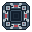

# Approved top-down pixel art — Fort and Quarry

These six **approved-by-owner** sprites are preserved at their original pixel dimensions. They were hand-programmed on a pixel grid using Python/Pillow, not generated by an image model. They were approved in the current chat on 22 October 2026 as the basis for iterating on **one building type at a time**.

| Building | Level 1 | Level 2 | Level 3 |
| --- | --- | --- | --- |
| Fort (rook tower, symmetric plan view) |  |  |  |
| Quarry (irregular open pit viewed vertically) |  |  |  |

**Preservation rules**

- Six individual 32×32 RGBA PNGs; transparent background.
- All six are unchanged byte-for-byte from the user's approved review files. Preserve original images even if later variants are created.
- Fort: orthogonal top-down rook silhouette, strict horizontal and vertical mirroring; three visible upgrade tiers.
- Quarry: open, irregular excavated pit with rocks, terraces and small mining equipment; no fort-like closed square walls; three visible tiers.
- **Do not silently replace the current game assets**. These images are a safe art-approval archive only. The existing gameplay and sprite rendering remain unchanged in this preservation commit. Integrate any revised design only after explicit approval.
- Never use an image-generation model to edit/recreate these particular assets. Edit pixel values or the project drawing code; preserve no-interpolation rendering (nearest-neighbor).

SHA-256 hashes of preserved files:

```text
fort/level-1.png    64543286d5222d03db02685348ad2be2b244b6e408ef2aab805b8f5d2feb6614
fort/level-2.png    5b59aae8216034446d80b8c49cb3a2268f9307e08e4fb804674e403d88e5cb6b
fort/level-3.png    9c6d7e3b91f10b8ee880bd2039b9573ff71fd7d4b15aad007ad39d62d5f882f9
quarry/level-1.png  16079d41cf0885ad3561dfa488e78932874bee2c8f2324cddd42629fd0e15601
quarry/level-2.png  b99459df4f50b78c1162f429310d32e2f7d76ddbb4de70252e25ced9d3b9ade0
quarry/level-3.png  c87a68ed70233f71a09ecdf0815d70587056344740b73871f7ae2a80ca762f54
```

The original authoring script was shared in the sprite-design conversation as `paint_rook_quarry.py`; it can be preserved here separately without requiring any change to the six original PNGs.
