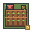

# Farm — manually pixel-drawn review drafts (22 Oct 2026)

**Now wired into the active game renderer for legacy Farm buildings; preview page is available on the Worker after deployment.** These three experimental PNGs are preserved for visual review, at original **32 × 32 RGBA**. No image generator, image-to-image transform, copied sprites, resampling or 3-D camera was used: each colored pixel was constructed from explicit Pillow primitives.

| Visual tier | Artwork | Visual goal |
| --- | --- | --- |
| Level 1 |  | Newly sown, predominantly brown tilled soil; sparse seedlings, tiny red-roof toolshed and water barrel. |
| Level 2 |  | Managed green crops, twin planted plots, distinct central blue irrigation run, bigger barn and harvested straw. |
| Level 3 |  | Mostly gold ripe wheat crops, central granary and threshing section. |

Design sources: layout principles observed in overhead farming games, but every pixel and tile composition is newly drawn; no third-party art bundled.

Quality contract: read as FARM on a crowded strategic map; level silhouettes differ by crop coverage, infrastructure and dominant color, not minor roof highlights. The level sprites remain exactly one world grid cell regardless of camera zoom. Flat orthographic plan-view; no facades or shading from perspective.

SHA-256 originals:

- `level-1.png`: `84d251fb064163dd61c58e4ce7c3b86c9389ef050af28a7c8c4b8bb53eb860b2`
- `level-2.png`: `8478fcc4ae2971a2fc2c8de9982b3f77289c5c20194a1160d19a67ae72b3b055`
- `level-3.png`: `4e069aa54d6e03c27cf40f4731bd52af7f3d1716f8b54013582c067a26a25275`

Do not change `game.js`, balance, previous approved Fort/Quarry art, or UI textures on the basis of this draft without explicit user approval. Previous rejected farm concepts are not to be silently promoted to active art.

## Published site preview

The separate review page [preview.html](preview.html) is copied by `scripts/build-cloudflare.cjs` into the Worker static assets. It lets players inspect the three variants even though current new matches auto-produce resources instead of placing Farms. This does not change the economy.
